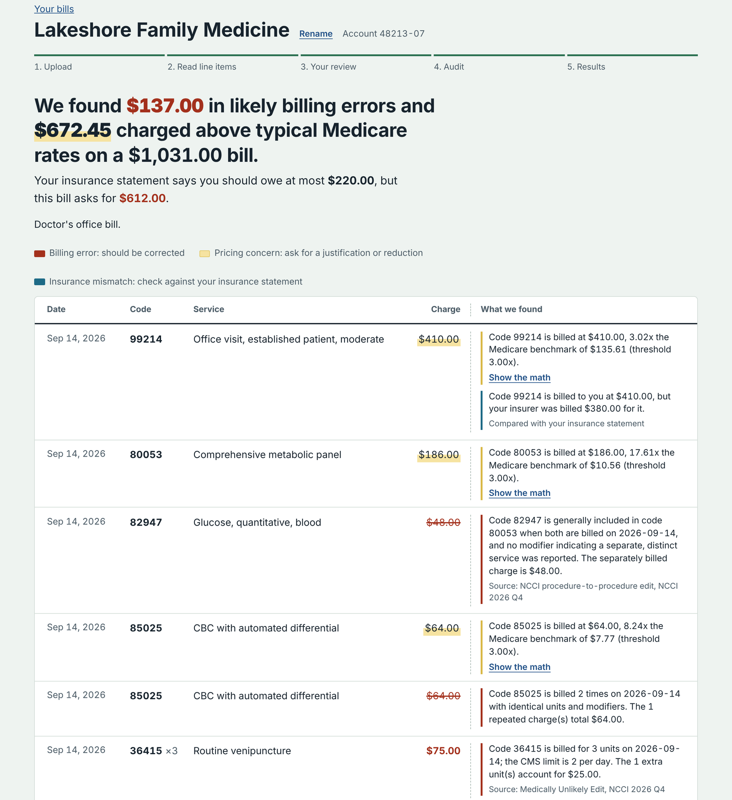

# ClaimCheck

**A full-stack medical bill auditor that pairs AI document extraction with deterministic checks against Medicare's official coding rules and payment rates.**

Itemized medical bills are dense pages of billing codes, and errors are easy to miss: a charge listed twice, a test billed separately when it's part of a panel, a balance higher than what insurance says the patient owes. ClaimCheck reads an uploaded bill, checks its billing codes against 3M+ Medicare coding rules, compares charges with 19K+ Medicare reference rates, identifies discrepancies with the patient's insurance statements, and drafts a dispute letter built only from verified findings.

**[Try the interactive sample-data demo](https://claimcheck-plum.vercel.app)**: no sign-up, uploads, or backend needed; it runs in the browser on a sample bill and insurance statement.

[How it works](#how-it-works) · [Benchmarks](#benchmark-results) · [Running locally](#running-locally) · [API](docs/api.md)

**Stack:** TypeScript · React · Node.js · Express · MongoDB · Agenda · AWS S3 · Gemini API · Docker · Jest · GitHub Actions



> ClaimCheck points out charges worth disputing; it doesn't certify that a bill is wrong, and it isn't legal or medical advice. Pricing concerns compare charges with Medicare rates, which are not what a private insurer agreed to pay.

## Engineering highlights

- **The model reads; code decides.** Gemini only extracts line items. Every extracted code is checked against the PDF's own text layer and Medicare's code list before the audit, and the model never reports its own confidence. All findings come from a pure TypeScript rules engine with 7 checks chosen by bill type.
- **Fast lookups over millions of rules.** Reference data for a whole bill loads in one indexed `$in` query per collection, run concurrently: 7 ms for a 100-line bill, 18x faster than per-line queries ([results](#benchmark-results)).
- **Insurance reconciliation.** Bill lines are matched to Explanation of Benefits lines by date, code, and amount, with a subset-sum search for statement lines that group several charges.
- **Grounded letters.** Each paragraph Gemini drafts must cite the finding's actual codes, dates, and amounts, or it's retried with feedback and finally replaced by a template paragraph built from the audit data.
- **Resilient background jobs.** Extraction, audit, and letter jobs run on a MongoDB-backed Agenda queue with retries, falling back across Gemini models when one is overloaded. Version checks keep a job that finishes after the patient changes something from overwriting newer results.
- **Tested access control.** JWT sessions in httpOnly cookies, bcrypt passwords, Origin checks against cross-site requests, and per-user ownership checks on every bill route, covered by integration tests against a real MongoDB in CI.

## Benchmark results

Measured with `npm run bench` ([what it does](docs/setup.md#benchmarks)) on a MacBook Air with MongoDB 7 in Docker, against 3,191,316 NCCI edits, 30,374 MUE limits, and 21,097 fee-schedule entries (19,011 priced rates and 2,086 packaged codes). Bills are synthetic but built from real codes and real NCCI code pairs; times are medians.

| Reference-data lookup | 10 lines | 100 lines | 500 lines |
|---|---|---|---|
| Batched, indexed (the app) | 0.6 ms | 6.9 ms | 91 ms |
| One indexed query per line | 7.2 ms | 125 ms | 899 ms |
| Full collection scan | 705 ms | 702 ms | 820 ms |
| Documents examined (batched vs scan) | 47 vs 3.24M | 1,804 vs 3.24M | 25,462 vs 3.24M |

The audit engine itself takes 0.9 ms for a 100-line bill once the data is loaded. On synthetic PDFs, the extraction verification layer detected 99.8% of 2,336 injected code and line-association errors (codes misread as other real or nonexistent codes, swapped lines), with no false positives across 1,168 correct lines, including rows whose description wraps onto a second printed line. This measures the verification checks, not Gemini's reading accuracy on real bills. The benchmark first exposed that wrapped rows were all being flagged, which led to the fix. Wrong charges aren't checked line by line; the bill-total check covers them.

## How it works

1. **Upload.** The browser uploads the PDF straight to S3 with a presigned URL. The Express API queues an extraction job.
2. **Extraction (worker).** Gemini turns the bill into structured line items and returns the exact text it read for each one. Code then verifies every item independently:
   - `foundInDocument`: the code appears in the PDF's own text layer (pdf.js)
   - `cmsMatch`: the code exists in Medicare's fee schedules
   - `descriptionMatch`: the bill's description resembles CMS's descriptor

   The model never reports confidence scores or page coordinates.
3. **Review.** The patient corrects flagged items, marks services not received, and answers whether they were formally admitted. A classifier combines that answer with signals on the bill (room-and-board and observation revenue codes, type-of-bill code) to pick the bill type.
4. **Audit (worker).** A pure TypeScript rules engine runs the checks valid for the bill type, using reference data fetched in one indexed query per collection.
5. **Insurance comparison (optional).** The patient can add the Explanation of Benefits (EOB) their insurer sent. Gemini extracts its lines, which are checked against the PDF's text the same way. A matching step pairs bill lines with EOB lines by date, then code, then billed amount, and also finds EOB lines that group several bill lines (for example, one "Laboratory services" line covering three lab tests) by searching for subsets of same-day charges that add up to the EOB amount. It then flags a balance higher than the patient can owe, charges no statement covers (possibly never submitted to insurance), and charges billed to the patient at a different price than the insurer was billed.
6. **Letter (worker).** Gemini returns one paragraph per finding as schema-constrained JSON. Code validates each paragraph with Zod and a fact check: every finding covered, no unknown findings, every dollar amount matching the audit, and the codes and amounts the billing office needs (for example, the charge and the Medicare rate) actually stated. It retries with the errors as feedback; any paragraph still wrong after that is replaced by a template paragraph built from the audit data, so a weak model answer never produces a vague letter.

**Model fallback.** Every Gemini call goes through a chain of Flash models set in `GEMINI_MODELS`, best first. A model that's overloaded (503), out of quota (429), or times out is skipped for a few minutes (10 for quota) and the request moves to the next one; a model the key can't use (404) is skipped for an hour; a bad request or invalid key (other 4xx) stops immediately, since every model would fail the same way. If every model is busy, the job queue retries the whole chain with growing waits (30 seconds up to 10 minutes) before giving up. The bill records which model read it and which drafted the letter. `npm run gemini:models` lists the model IDs your key can use.

| Check | Doctor | Hospital outpatient | Inpatient / uncertain |
|---|---|---|---|
| Duplicates | ✓ | ✓ | ✓ |
| Math errors | ✓ | ✓ | ✓ |
| Unbundling (NCCI) | practitioner table | hospital table | skipped |
| Unit limits (MUE) | practitioner table | hospital table | skipped |
| Pricing vs. Medicare | PFS facility/non-facility | OPPS, lab fee schedule | skipped |
| Not received | ✓ | ✓ | ✓ |
| Charges outside the stay | | | ✓ |

**Pricing threshold.** Charges above `BENCHMARK_MULTIPLIER` (default 3x) times the Medicare benchmark are flagged as *benchmark outliers*, a pricing concern rather than a billing error. Hospital list prices and commercial negotiated rates commonly run well above Medicare, so a low threshold would flag nearly everything. Every flag shows the benchmark, charge, ratio, and threshold.

## Running locally

You need Docker Desktop, an S3 bucket, and a Gemini API key. The [setup guide](docs/setup.md) covers a non-Docker install, the S3 settings, and each step in detail.

```bash
cp server/.env.example server/.env   # fill in your keys
docker compose up --build            # MongoDB, the API on :4000, and the job worker
```

Load the Medicare data once ([which files, and the import commands](docs/setup.md#loading-medicare-data)), then start the React app:

```bash
cd client && npm install && npm run dev               # http://localhost:5173
VITE_DEMO=1 npm run dev                               # or the sample-data demo, no backend needed
```

Tests and benchmarks run from `server/`:

```bash
MONGODB_TEST_URI=mongodb://localhost:27017 npm test   # unit and API integration tests
npm run bench                                         # lookup, audit, and extraction-check benchmarks
```

The REST endpoints are listed in the [API reference](docs/api.md).
